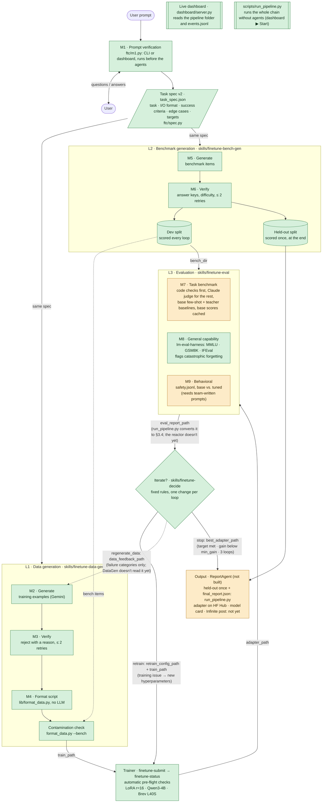

# Wireframe v0.2: the fine-tuning collective

*The design everything in this repo builds, drawn **as built (2026-11-01, after BenchGen and run_pipeline.py landed)**: box colours show status, arrows carry the real hand-off keys (the JSON keys the ScienceClaw reactor matches to the next skill's `--flags`). Original interactive version: https://claude.ai/artifact/CaQXjvVYfHTfFpGgNz2feQ · PDF: `docs/Claude_Wireframe_v0.2.pdf` (hand-drawn v0.1: `docs/Wireframe_v0.1.pdf`). Critique and build advice: `docs/wireframe_v0.2_review.md`. File formats between the boxes: `docs/spec_and_io.md`.*

**Legend:** green = built · amber = built, but not connected yet (the note says why) · grey dashed = not built · dotted arrow = planned hand-off that nothing reads yet.

## What changed from v0.1

- **Trainer step added.** v0.1 went from data straight to evaluation.
- **Decision node with two loops.** Data problems go back to L1; training problems only change hyperparameters, which is much faster.
- **Shared task spec.** M1 outputs one structured spec that both L1 and L2 read.
- **M4 is a script.** Formatting is deterministic, so it needs no LLM.
- **Benchmark protection.** Contamination check, a held-out split, and feedback that names failure categories, not test items.
- **Retry caps and output.** Generate/verify loops capped at 2 retries; stop criteria and deliverables are explicit.

## Where each box lives

| Box | Code | Status |
|---|---|---|
| M1 · Prompt verification | `ftc/m1.py` (CLI, and the dashboard's *New task* page) | Built. Runs before the agents, since ScienceClaw can't pause to ask a human |
| Task spec | `ftc/spec.py` (v2, superset of DataGen's v1) | Built |
| L1 · M2–M4 + contamination | `skills/finetune-data-gen` (`lib/format_data.py` = M4, `--bench` = contamination check) | Built. Doesn't read the Evaluator's `data_feedback_path` yet |
| L2 · M5–M6, dev / held-out | `skills/finetune-bench-gen` (`docs/benchgen-progress.md`) | Built. Item format: `docs/spec_and_io.md` §3.2 |
| Trainer | `skills/finetune-submit`, `skills/finetune-status`, `scripts/brev-smoke/train_sft.py` | Built, with automatic pre-flight checks |
| L3 · M7–M9 | `skills/finetune-eval` | Built and smoke-tested. Writes its own report format; `run_pipeline.py` converts it to §3.4 (`ftc/report_convert.py`). M9 needs a team-written `safety.jsonl` |
| Iterate? · Evaluator | `skills/finetune-decide` | Built (rules: `docs/evaluator-notes.md`) |
| Output | (`ReportAgent`, planned) | **Partly:** `run_pipeline.py` scores held-out once and writes `final/final_report.json`. HF push (`train_sft.py --push-to-hub` exists), model card and Infinite post aren't built |
| *(not in the wireframe)* Live view | `dashboard/`, `ftc/pipeline.py` event log, `scripts/simulate_pipeline.py` | Built |
| *(not in the wireframe)* Runner | `scripts/run_pipeline.py` | Built: the whole chain as subprocesses, no agents |
